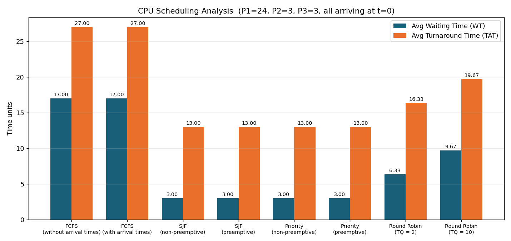

# Experiment 3 — Banker's Algorithm and Analysis of the Scheduling Algorithms

**Subject:** Operating Systems Lab  |  **Roll no:** 25071A6245

## Banker's Algorithm

**Aim:** Write a C program for Banker's algorithm

### Banker's Algorithm (Safe / Unsafe state check)

**Source:** [`bankers_algorithm.c`](bankers_algorithm.c)

#### Test case 1

```text
Roll no: 25071A6245
Enter number of processes: 3
Enter number of resource types: 3
Enter Allocation Matrix:
0 1 0
2 0 0
3 0 2
Enter Max Matrix:
7 5 3
3 2 2
9 0 2
Enter Available Resources:
3 3 2

System is in an UNSAFE STATE (Deadlock possible).
```

#### Test case 2

```text
Roll no: 25071A6245
Enter number of processes: 4
Enter number of resource types: 3
Enter Allocation Matrix:
0 1 0
2 0 0
3 0 2
2 1 1
Enter Max Matrix:
7 5 3
3 2 2
9 0 2
2 2 2
Enter Available Resources:
3 3 2

System is in a SAFE STATE.
Safe Sequence: P2 P4 P1 P3
```

#### Test case 3

```text
Roll no: 25071A6245
Enter number of processes: 4
Enter number of resource types: 3
Enter Allocation Matrix:
1 0 1
2 1 1
0 1 3
3 2 1
Enter Max Matrix:
5 4 4
4 3 3
2 2 5
4 3 3
Enter Available Resources:
1 1 0

System is in an UNSAFE STATE (Deadlock possible).
```

---

## Analysis of all Scheduling Algorithms

**Aim:** Make the analysis of all scheduling algorithms

Every algorithm was run on the same workload — **P1 (BT 24), P2 (BT 3), P3 (BT 3)**, all arriving at time 0 (priorities 3, 1, 2 for the priority algorithms).

| Algorithm | Avg Waiting Time | Avg Turnaround Time |
|---|---:|---:|
| FCFS (without arrival times) | 17.00 | 27.00 |
| FCFS (with arrival times) | 17.00 | 27.00 |
| SJF (non-preemptive) | 3.00 | 13.00 |
| SJF (preemptive) | 3.00 | 13.00 |
| Priority (non-preemptive) | 3.00 | 13.00 |
| Priority (preemptive) | 3.00 | 13.00 |
| Round Robin (TQ = 2) | 6.33 | 16.33 |
| Round Robin (TQ = 10) | 9.67 | 19.67 |



### Test cases used for the analysis

<details><summary><b>FCFS (without arrival times)</b> — <code>fcfs_without_arrival.c</code></summary>

```text
Roll no: 25071A6245
Enter number of processes: 3
Enter Burst Time for P1: 24
Enter Burst Time for P2: 3
Enter Burst Time for P3: 3

Process BT      WT      TAT
P1      24      0       24
P2      3       24      27
P3      3       27      30

Avg WT = 17.00 | Avg TAT = 27.00
```

</details>

<details><summary><b>FCFS (with arrival times)</b> — <code>fcfs_with_arrival.c</code></summary>

```text
Roll no: 25071A6245
Enter number of processes: 3
Enter Arrival Time and Burst Time for P1: 0 24
Enter Arrival Time and Burst Time for P2: 0 3
Enter Arrival Time and Burst Time for P3: 0 3

Process AT      BT      CT      WT      TAT
P1      0       24      24      0       24
P2      0       3       27      24      27
P3      0       3       30      27      30

Average Waiting Time = 17.00
Average Turnaround Time = 27.00
```

</details>

<details><summary><b>SJF (non-preemptive)</b> — <code>sjf_non_preemptive.c</code></summary>

```text
Roll no: 25071A6245
Enter number of processes: 3
Enter Arrival Time and Burst Time for P1: 0 24
Enter Arrival Time and Burst Time for P2: 0 3
Enter Arrival Time and Burst Time for P3: 0 3

Process AT      BT      CT      WT      TAT
P1      0       24      30      6       30
P2      0       3       3       0       3
P3      0       3       6       3       6

Average Waiting Time = 3.00
Average Turnaround Time = 13.00
```

</details>

<details><summary><b>SJF (preemptive)</b> — <code>sjf_preemptive.c</code></summary>

```text
Roll no: 25071A6245
Enter number of processes: 3
Enter Arrival Time and Burst Time for P1: 0 24
Enter Arrival Time and Burst Time for P2: 0 3
Enter Arrival Time and Burst Time for P3: 0 3

Process AT      BT      CT      WT      TAT
P1      0       24      30      6       30
P2      0       3       3       0       3
P3      0       3       6       3       6

Average Waiting Time = 3.00
Average Turnaround Time = 13.00
```

</details>

<details><summary><b>Priority (non-preemptive)</b> — <code>priority_non_preemptive.c</code></summary>

```text
Roll no: 25071A6245
Enter number of processes: 3
Enter Arrival Time, Burst Time and Priority for P1: 0 24 3
Enter Arrival Time, Burst Time and Priority for P2: 0 3 1
Enter Arrival Time, Burst Time and Priority for P3: 0 3 2

Process AT      BT      Pr      CT      WT      TAT
P1      0       24      3       30      6       30
P2      0       3       1       3       0       3
P3      0       3       2       6       3       6

Average Waiting Time = 3.00
Average Turnaround Time = 13.00
```

</details>

<details><summary><b>Priority (preemptive)</b> — <code>priority_preemptive.c</code></summary>

```text
Roll no: 25071A6245
Enter number of processes: 3
Enter Arrival Time, Burst Time and Priority for P1: 0 24 3
Enter Arrival Time, Burst Time and Priority for P2: 0 3 1
Enter Arrival Time, Burst Time and Priority for P3: 0 3 2

Process AT      BT      Pr      CT      WT      TAT
P1      0       24      3       30      6       30
P2      0       3       1       3       0       3
P3      0       3       2       6       3       6

Average Waiting Time = 3.00
Average Turnaround Time = 13.00
```

</details>

<details><summary><b>Round Robin (TQ = 2)</b> — <code>round_robin_tq2.c</code></summary>

```text
Roll no: 25071A6245
Enter number of processes: 3
Enter Arrival Time and Burst Time for P1: 0 24
Enter Arrival Time and Burst Time for P2: 0 3
Enter Arrival Time and Burst Time for P3: 0 3

Process AT      BT      CT      WT      TAT
P1      0       24      30      6       30
P2      0       3       9       6       9
P3      0       3       10      7       10

Average Waiting Time = 6.33
Average Turnaround Time = 16.33
```

</details>

<details><summary><b>Round Robin (TQ = 10)</b> — <code>round_robin_tq10.c</code></summary>

```text
Roll no: 25071A6245
Enter number of processes: 3
Enter Arrival Time and Burst Time for P1: 0 24
Enter Arrival Time and Burst Time for P2: 0 3
Enter Arrival Time and Burst Time for P3: 0 3

Process AT      BT      CT      WT      TAT
P1      0       24      30      6       30
P2      0       3       13      10      13
P3      0       3       16      13      16

Average Waiting Time = 9.67
Average Turnaround Time = 19.67
```

</details>
